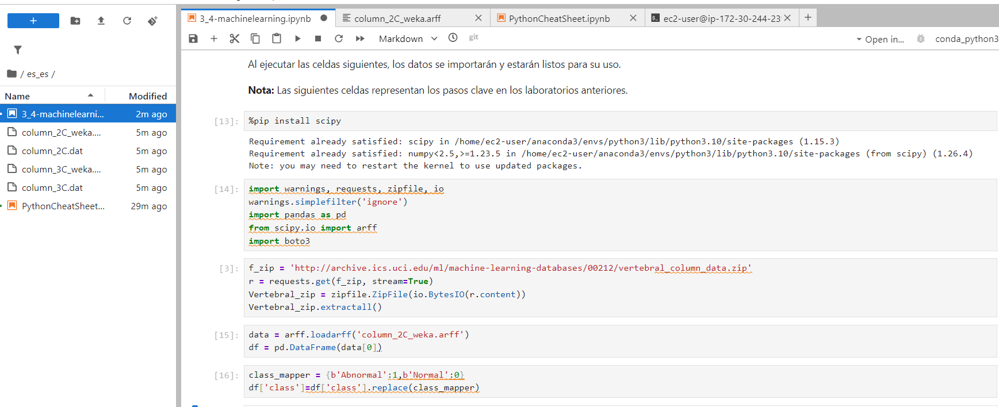
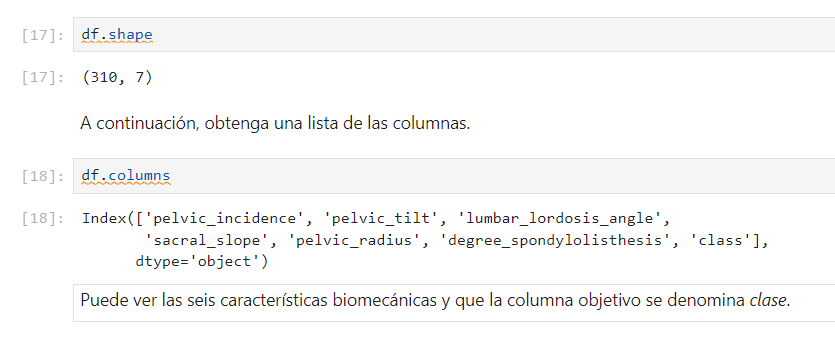
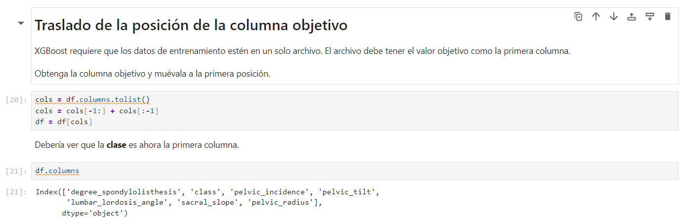
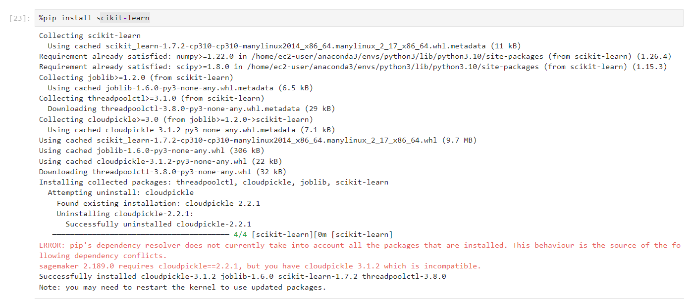
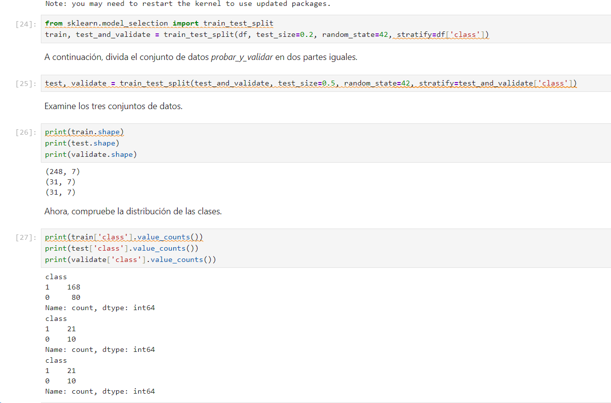
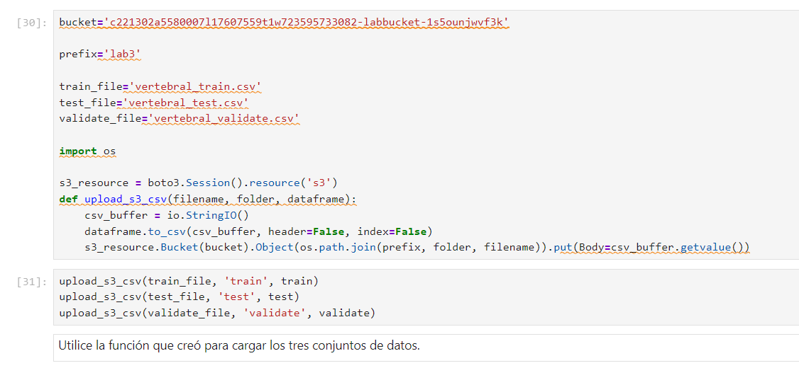
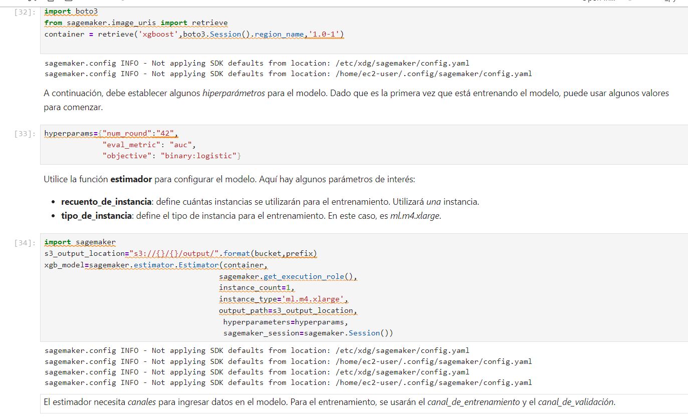
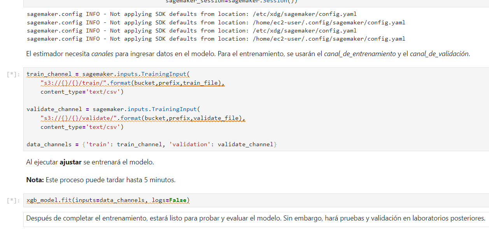

# Laboratorio 3.4

En este laboratorio se preparó el conjunto de datos de columna vertebral, se separó en conjuntos de entrenamiento, prueba y validación, y se configuró un trabajo de entrenamiento XGBoost en SageMaker.

## Preparación de los datos

Se cargó el archivo ARFF y se exploraron sus dimensiones y columnas. El conjunto contiene 310 registros, seis características biomecánicas y la variable objetivo `class`.

Se colocó `class` como primera columna, formato requerido por el contenedor XGBoost utilizado en el laboratorio.

Se instaló scikit-learn para usar `train_test_split` en la partición estratificada.

La partición reproducible reservó 80 % para entrenamiento y dividió el 20 % restante por igual entre prueba y validación. `stratify` conservó la proporción de clases: entrenamiento `(248, 7)`, prueba `(31, 7)` y validación `(31, 7)`.

## Carga a S3 y entrenamiento

Se exportaron los tres conjuntos como CSV sin encabezados ni índice de pandas y se cargaron en las rutas de S3 del laboratorio.

Se configuró XGBoost para clasificación binaria con `binary:logistic`, métrica AUC y 42 rondas. El estimador usa los canales `train` y `validation` para iniciar el entrenamiento.

La última captura de este laboratorio muestra el trabajo en ejecución. La captura de finalización se conserva en las evidencias del laboratorio 3.5.
