# Laboratorio 3.5

En este laboratorio se cargó de nuevo el conjunto de datos para el entorno del laboratorio, se entrenó un estimador XGBoost y se probaron la inferencia en tiempo real y la transformación por lotes.

## Preparación y despliegue

Se instalaron las dependencias que faltaban en el kernel y se importaron las librerías necesarias para los datos, SageMaker y la partición estratificada.

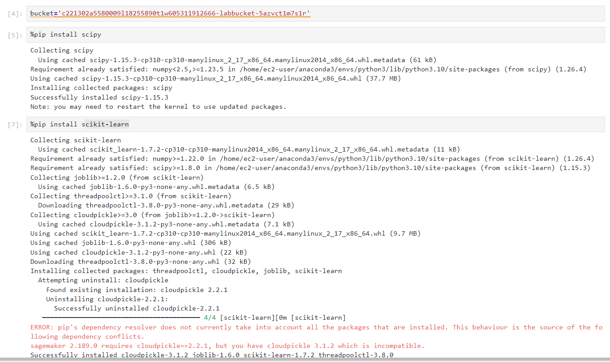

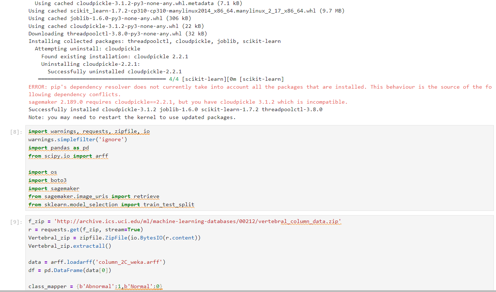

Se prepararon los conjuntos de entrenamiento, prueba y validación y se cargaron los CSV al bucket asignado a este laboratorio.

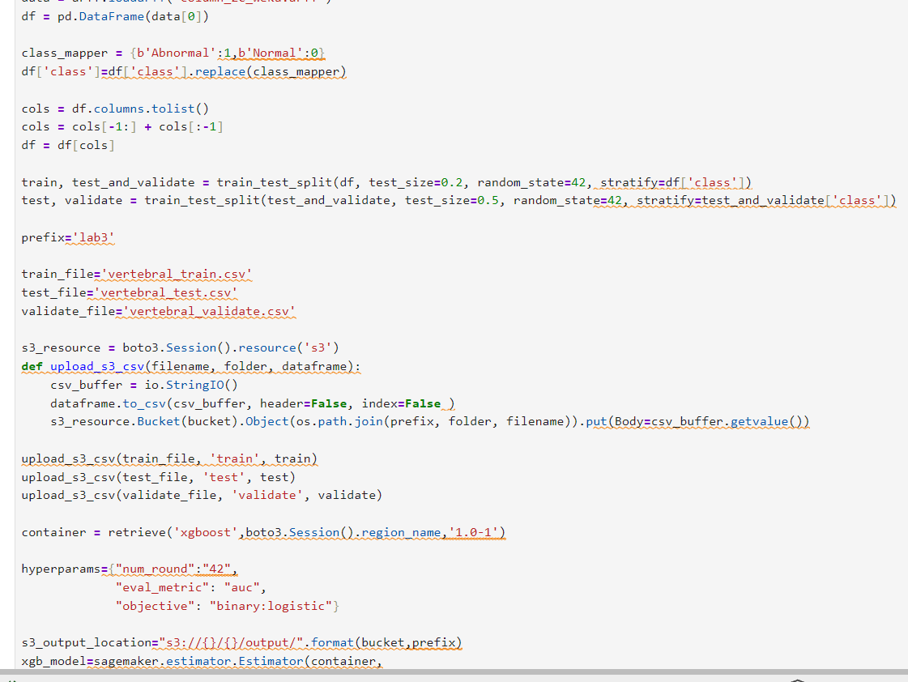

El trabajo de entrenamiento terminó correctamente y el notebook mostró `ready for hosting!`.

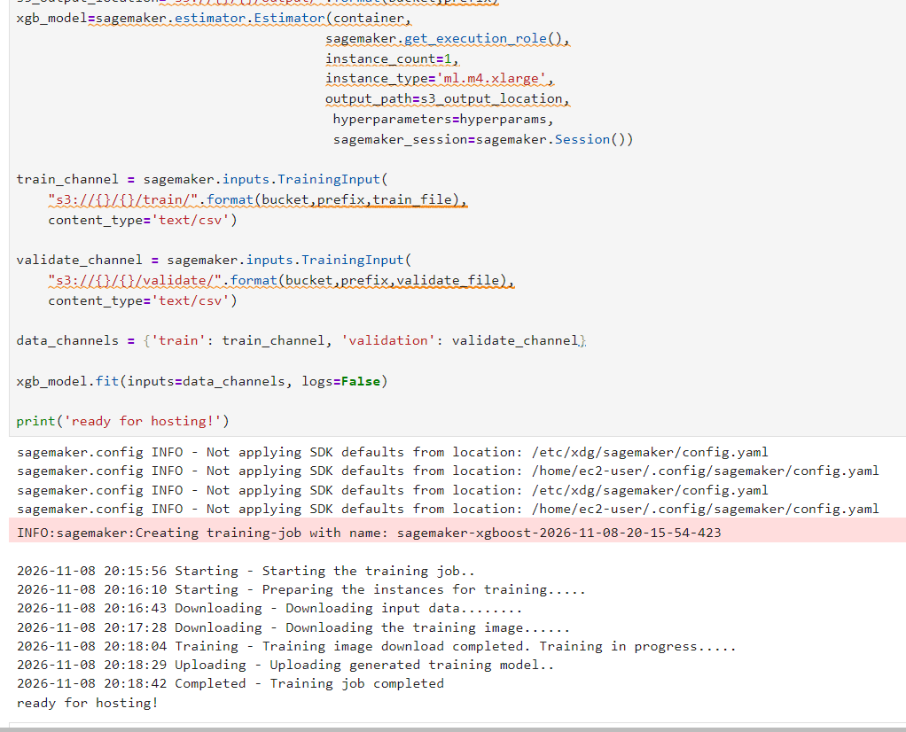

Se desplegó el modelo en un endpoint de tiempo real para consultar predicciones.

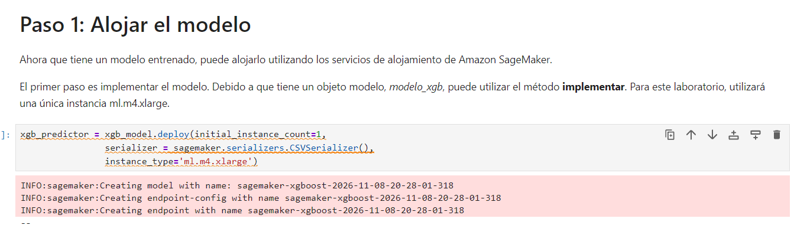

## Predicción en tiempo real

Se revisó el conjunto de prueba, que contiene 31 registros. Para predecir, se omitió la columna `class` y se enviaron únicamente las seis características.

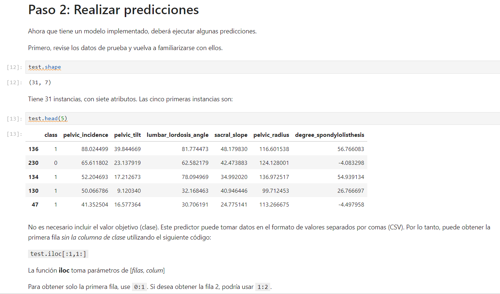

La captura muestra la primera fila de prueba (índice 136) convertida a CSV y una puntuación devuelta por el endpoint: `0.9966071844100952`. Como `class=1` representa **anormal** y `class=0` representa **normal**, esa puntuación indica una probabilidad alta de clase anormal para esa fila.

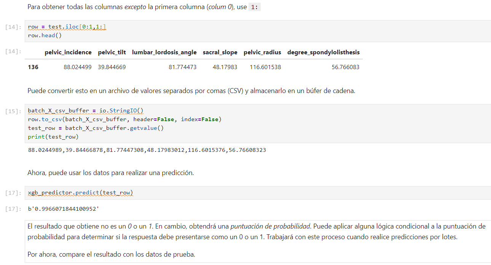

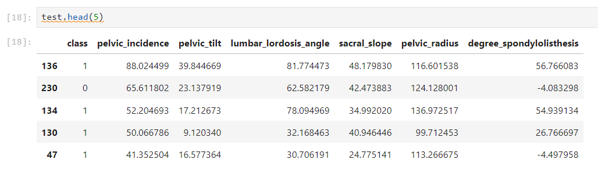

La actividad también solicita consultar la entrada `63.0,12.5,45.0,50.5,125.0,3.0`. Su salida exacta aún no está en estas capturas; se añadirá después de ejecutar esa validación. La puntuación de la fila 136 anterior no corresponde a esa entrada.

## Cierre del endpoint y transformación por lotes

Tras las consultas en tiempo real, se solicitó eliminar el endpoint y su configuración para liberar los recursos de alojamiento.

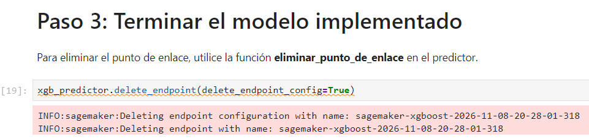

Para la inferencia por lotes, se separaron las seis características de `test` y se cargó el CSV de entrada a S3 sin incluir la etiqueta objetivo.

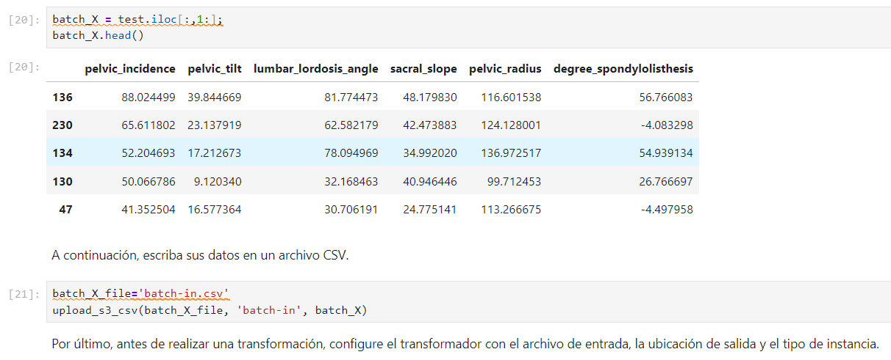

Se configuró un transformador de SageMaker con entrada y salida en S3 y se inició el trabajo por lotes. La captura también muestra el código para descargar su resultado.

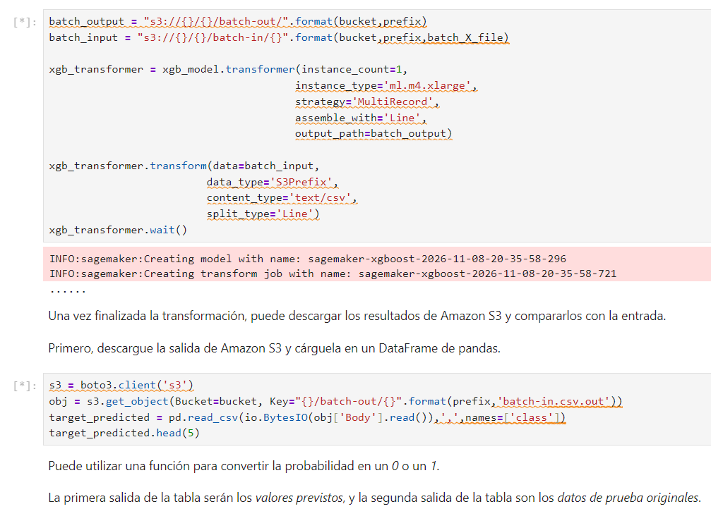

Se definió una regla con umbral `0.65` para convertir puntuaciones de probabilidad en etiquetas binarias: mayor que 0.65 se convierte en clase 1; en caso contrario, clase 0. La captura contiene el código de conversión, pero no la salida final de la tabla.

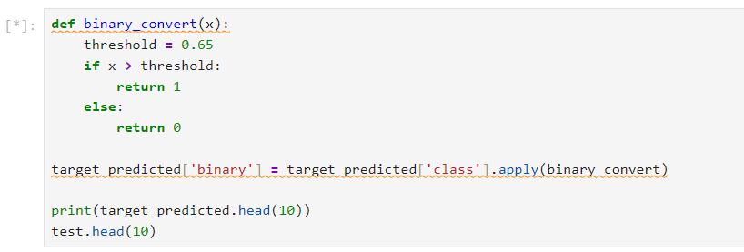
